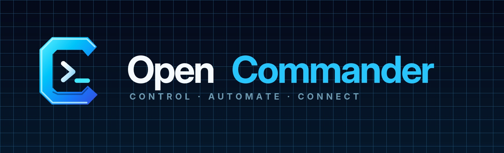
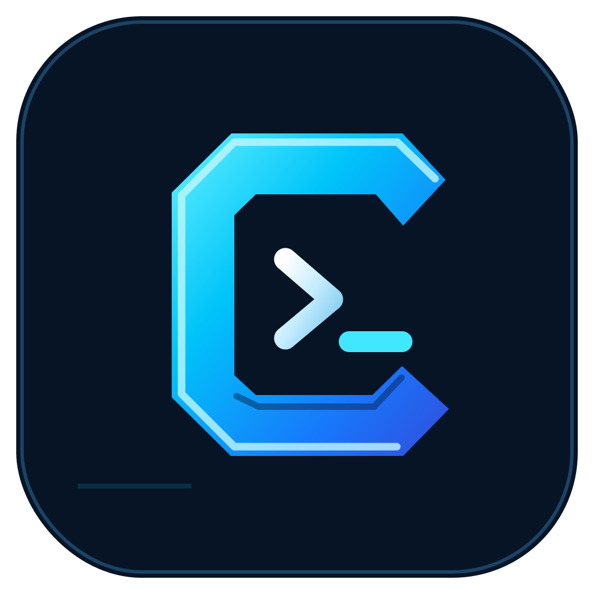
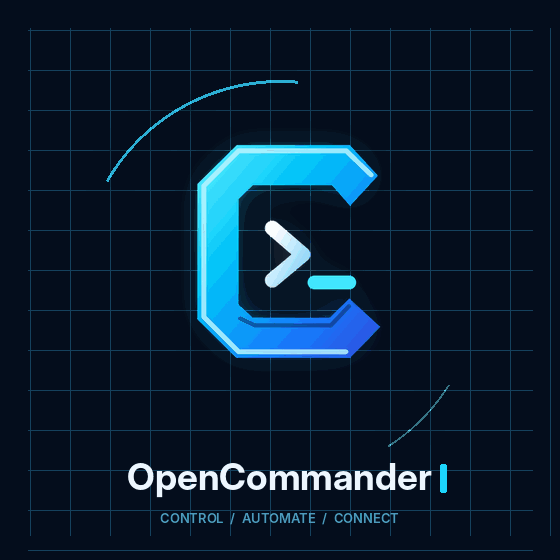
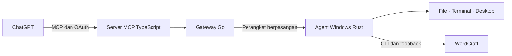

<p align="center">
  
</p>

<h1 align="center"> OpenCommander</h1>

<p align="center">
  <b>Kendalikan Windows dan kerjakan dokumen WordCraft dari percakapan ChatGPT.</b><br>
  Agent native Rust, terminal interaktif, otomasi desktop, transfer file, dan editor dokumen melalui MCP.
</p>

<p align="center">
  <a href="https://github.com/NoHeart6/open/releases/latest"></a>
  
  
  
  <a href="LICENSE"></a>
</p>

<p align="center">
  <a href="https://github.com/NoHeart6/open/releases/latest"><b>⬇ Unduh Windows</b></a> ·
  <a href="docs/PLUGIN_ACCESS.md"><b>🔌 Akses plugin</b></a> ·
  <a href="#wordcraft"><b>📝 WordCraft</b></a> ·
  <a href="docs/INSTALL_WINDOWS.md"><b>Panduan lengkap</b></a>
</p>

## Dari percakapan ke pekerjaan di PC

<table>
<tr>
<td width="24%" align="center">
  <br>
  <sub>Control · Automate · Connect</sub>
</td>
<td>

OpenCommander menghubungkan AI di ChatGPT dengan komputer Windows yang dipasangkan oleh pemiliknya. Baca file, jalankan terminal, inspeksi aplikasi, dan buat dokumen dengan izin yang dikelola di PC.

Versi **0.5.0** menyediakan **42 tools MCP**, termasuk ekspor file, workflow dengan checkpoint, penyusunan DOCX melalui WordCraft, dan aksi UI dengan pemeriksaan hasil. Penalaran AI berlangsung di ChatGPT; agent Windows menjalankan tindakan melalui Rust.

</td>
</tr>
</table>

| | Kemampuan | Yang tersedia |
| :--: | :-- | :-- |
| 🖥️ | Desktop Windows | Screenshot, daftar jendela, UI Automation, fokus, klik, drag, scroll, dan input teks. |
| ⌨️ | Terminal interaktif | Hingga empat task bersamaan, stdin/EOF pada pipe, ConPTY untuk TUI, input tombol, resize, dan pembacaan layar terminal. |
| 📁 | File dan media | Baca, tulis, cari, batch/undo, transfer bertahap hingga 512 MiB, serta ekspor bytes ke pemanggil. |
| 📝 | WordCraft | Akses 16 tools editor native dan pembuatan DOCX dengan judul, paragraf, gambar, caption, dan tabel. |
| 🔁 | Workflow | Hingga 20 langkah berurutan, checkpoint tersimpan, pemeriksaan hasil, dan pelanjutan langkah yang sudah selesai. |
| 🔐 | Izin lokal | Pairing, OAuth, folder yang disetujui, allowlist aplikasi, dan konfirmasi native tindakan sensitif secara default. |

## Unduh dan mulai

Semua berkas ada di **[GitHub Releases](https://github.com/NoHeart6/open/releases/latest)**. Binary Windows diterbitkan sebagai aset rilis; source tersedia di repository ini.

| Unduhan | Kegunaan |
| :-- | :-- |
| [OpenCommanderSetup.exe](https://github.com/NoHeart6/open/releases/download/v0.5.0/OpenCommanderSetup.exe) | Installer Windows x64 dari build Rust 0.5.0. |
| [opencommander-agent.exe](https://github.com/NoHeart6/open/releases/download/v0.5.0/opencommander-agent.exe) | Executable agent Rust untuk penggunaan manual; lihat `--help`. |
| [OpenCommander-Windows-0.5.0.zip](https://github.com/NoHeart6/open/releases/download/v0.5.0/OpenCommander-Windows-0.5.0.zip) | Installer, agent, petunjuk instalasi, dan lisensi dependency. |
| [OpenCommander-plugin-0.5.0.zip](https://github.com/NoHeart6/open/releases/download/v0.5.0/OpenCommander-plugin-0.5.0.zip) | Manifest MCP dan skill kontrol Windows/WordCraft untuk host yang mendukung format plugin ini. |
| [WordCraft 0.7.0 portable](https://github.com/NoHeart6/open/releases/download/v0.5.0/wordcraft-0.7.0-windows-x64-portable.zip) | `wordcraft.exe`, `wordcraft-cli.exe`, dan lisensi upstream. |
| [SHA256SUMS.txt](https://github.com/NoHeart6/open/releases/download/v0.5.0/SHA256SUMS.txt) | Checksum seluruh aset unduhan. |

1. **Pasang agent.** Jalankan `OpenCommanderSetup.exe`, lalu buka UI OpenCommander untuk pairing dan mengatur akses. Untuk upgrade, gunakan `OpenCommanderSetup.exe --upgrade`; pairing dan kebijakan lokal dipertahankan.
2. **Hubungkan plugin.** Buka [halaman Plugins ChatGPT](https://chatgpt.com/plugins), tambahkan server MCP kustom berikut, pilih OAuth, lalu login dan pasangkan perangkat.

   ```text
   https://mcp-production-394c.up.railway.app/mcp
   ```

3. **Periksa koneksi.** Mulai dengan `device_list`, lalu `system_info` untuk memastikan perangkat, versi agent, dan folder yang diizinkan.
4. **Tambahkan WordCraft** jika ingin mengolah dokumen; langkahnya ada di bawah.

Paket plugin ZIP disediakan bersama [panduan akses](docs/PLUGIN_ACCESS.md). Ketersediaan penambahan server MCP kustom mengikuti fitur akun/host ChatGPT. Setelah pembaruan tools, refresh koneksi yang sudah ada dan mulai percakapan baru.

> Binary Windows **belum ditandatangani Authenticode**. Metadata updater memakai Ed25519; checksum SHA-256 tersedia terpisah untuk unduhan GitHub.

<a id="wordcraft"></a>

## WordCraft

<p>
  
  <b>Editor dokumen native Rust dengan akses MCP.</b><br>
  OpenCommander meneruskan permintaan editor ke WordCraft lokal melalui CLI resminya.
</p>

<p align="center">
  <br>
  <sub>Tampilan contoh dari proyek WordCraft upstream, bukan rekaman workflow ChatGPT.</sub>
</p>

Ekstrak [WordCraft portable](https://github.com/NoHeart6/open/releases/download/v0.5.0/wordcraft-0.7.0-windows-x64-portable.zip) ke folder pilihan Anda. Dari folder yang berisi executable, jalankan:

```powershell
.\wordcraft.exe --control 7981
```

Izinkan aplikasi WordCraft/CLI serta folder dokumen yang diperlukan di UI OpenCommander. Pada tool `wordcraft`, berikan path absolut `cli_path` ke `wordcraft-cli.exe`, `port: 7981`, nama `tool`, dan `arguments`. Mulai dengan `list_commands` agar AI membaca perintah editor yang tersedia.

| Pekerjaan | Tool |
| :-- | :-- |
| Membaca dan menyunting | `get_text`, `type_text`, `select_text`, `execute`, `batch` |
| Mengelola dokumen | `new_document`, `open_document`, `save_document`, `inspect_document` |
| Melihat hasil | `render_page`, `screenshot`, `ui_inspect` |
| Mengendalikan editor | `click`, `key`, `list_commands`, `parity` |
| Menyusun DOCX dari blok | `wordcraft_compose` di OpenCommander; hingga 80 blok termasuk gambar, caption, dan tabel. |

Contoh permintaan setelah terhubung:

> Gunakan WordCraft untuk membuat laporan dengan judul, dua bagian, tabel ringkasan, dan gambar yang saya lampirkan. Simpan sebagai DOCX di folder yang saya izinkan, lalu periksa dokumen dan hasil simpanannya.

Transfer gambar dari chat memerlukan file atau URL unduhan yang benar-benar diberikan host. Path internal `sandbox:/...` saja tidak dapat diunduh agent. Ekspor file besar ke pemanggil dilakukan dalam chunk; lampiran ChatGPT otomatis belum dijamin. Lihat [batas transfer dan workflow](docs/INSTALL_WINDOWS.md).

WordCraft dibuat oleh [proyek WordCraft / ArtCraft](https://github.com/storytold/wordcraft) dan didistribusikan ulang dengan lisensi **MIT OR Apache-2.0** serta pemberitahuan font yang disertakan. [Kredit aset](docs/assets/README.md).

## Cara kerja



Instalasi baru menggunakan folder terbatas, allowlist aplikasi, dan konfirmasi tindakan sensitif. Pemilik mengatur akses melalui UI native; upgrade mempertahankan kebijakan yang sudah dipilih. Kontrol WordCraft mendengarkan di loopback dan kuncinya tetap lokal. Detail: [keamanan](docs/SECURITY.md) dan [instalasi Windows](docs/INSTALL_WINDOWS.md).

## Dokumentasi dan pengembangan

| Panduan | Isi |
| :-- | :-- |
| [Instalasi Windows](docs/INSTALL_WINDOWS.md) | Pairing, izin, terminal, media, WordCraft, dan workflow. |
| [Akses plugin](docs/PLUGIN_ACCESS.md) | Koneksi ChatGPT, isi ZIP, konfigurasi MCP, dan WordCraft lokal. |
| [Catatan rilis 0.5.0](docs/releases/v0.5.0.md) | Isi unduhan, asal binary, dan verifikasi paket. |
| [Troubleshooting](docs/TROUBLESHOOTING.md) | Diagnosis koneksi dan masalah umum. |
| [Validasi ChatGPT](docs/VALIDATION_CHATGPT.md) | Membedakan pengujian klien MCP dari bukti pada host ChatGPT. |

Source utama: `apps/windows-agent/` (Rust), `apps/gateway/` (Go), `apps/mcp-server/` (TypeScript), dan `plugins/opencommander/` (paket plugin).

```powershell
.\scripts\build.ps1 -Release
.\scripts\package.ps1
.\scripts\diagnose-chatgpt-integration.ps1
```

Pengujian: `cargo test --locked` dan `cargo clippy --locked --all-targets -- -D warnings` pada agent; `go test ./...` pada gateway; `npm run lint`, `npm run typecheck`, dan `npm test` pada server MCP. Diagnosis produksi memakai kredensial lokal terenkripsi; jangan memasukkan token, database, atau screenshot privat ke Git atau paket rilis.

OpenCommander berlisensi [MIT](LICENSE). Dependency mempertahankan [lisensi dan pemberitahuannya](THIRD_PARTY_NOTICES.md).
